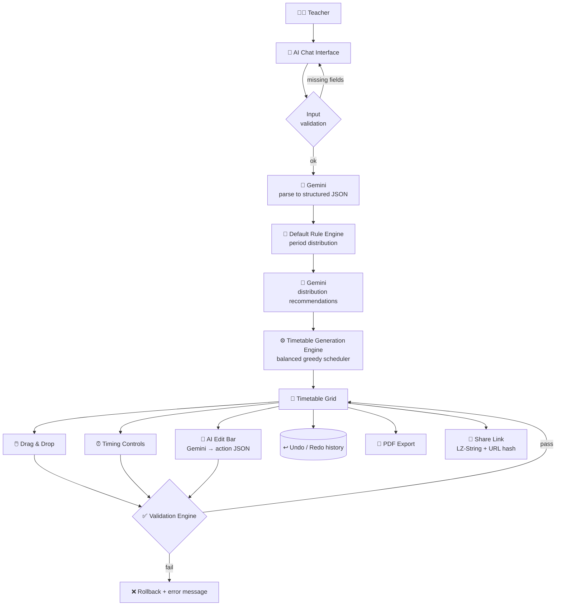

# 🕒 Time-Pilot
### *Your AI Timetable Assistant: Generate. Optimize. Edit.*

> Tell it your subjects, teachers and timings. Get a clash-free timetable in seconds, then tweak it by dragging cells or just by *talking to it*.

🛠️ **100% frontend. No backend. No database.**

---

## 🎯 Problem Statement

Building a school or college timetable by hand is slow, fiddly and error-prone:

- ⚖️ Balancing subjects and periods across the week takes ages
- 💥 Teacher clashes and break-time overlaps sneak in easily
- 🔁 A last-minute change means redoing half the grid
- 📤 Sharing the updated version with everyone is a hassle
- 🤷 Traditional timetable tools don't understand plain-language requests

---

## 💡 Solution

**Time-Pilot** is an AI-powered timetable assistant for teachers, school administrators and college faculty. You describe your requirements in a chat (subjects, teachers, working days, school timing, break timing and class duration) and Time-Pilot:

1. **Understands** your input with Google Gemini and turns it into structured data
2. **Generates** a balanced timetable with a scheduling engine
3. **Lets you edit** it by drag-and-drop, timing controls or natural-language commands
4. **Validates** every change so you never end up with a clash
5. **Exports** it as a PDF or **shares** it as a link

---

## ✨ Features

| | Feature | What it does |
|---|---|---|
| 🤖 | **AI timetable generation** | Gemini parses your chat input into structured data and recommends a balanced subject distribution |
| 💬 | **Natural-language editing** | Type "Swap Physics and English" or "Move Maths to Tuesday morning" |
| 📅 | **Interactive timetable grid** | Days × periods, with break and buffer rows clearly marked |
| 🖱️ | **Drag-and-drop editing** | Swap subjects on desktop; touch-and-hold on mobile |
| ⏰ | **Dynamic time adjustment** | Change start/end time, break time or class duration and every period recalculates |
| ✅ | **Real-time validation** | Teacher clashes, duplicate slots, break conflicts and time overruns are blocked and rolled back, with clear messages |
| ↩️ | **Undo / Redo** | 30-step edit history (Ctrl+Z / Ctrl+Y) |
| 📄 | **PDF export** | Print-ready timetable with your school name header |
| 🔗 | **Shareable links** | The whole timetable is compressed into a URL, with no server needed |
| 🌙 | **Dark mode** | Saved preference, respects system theme |
| 📱 | **Fully responsive** | Works from 320px phones to wide desktops |
| 🛡️ | **Smart error handling** | Input checks before the AI call, loading states and friendly retry messages |

---

## 🛠️ Tech Stack

| Layer | Technology |
|---|---|
| UI framework | React |
| Language | JavaScript (ES6+) |
| Build tool | Vite |
| Styling | Tailwind CSS (class-based dark mode) |
| AI | Google Gemini API |
| Routing | React Router |
| Drag & drop | dnd-kit |
| PDF | jsPDF + jspdf-autotable |
| Link sharing | LZ-String compression + URL hash |
| Icons | Lucide React |
| State | React state (Context / reducer), optional localStorage |
| CI / Deploy | GitHub Actions |

---

## 🏗️ System Architecture



**Everything runs in the browser.** Scheduling, validation, undo history, PDF and link generation are client-side JavaScript. The only network call is to the Gemini API, so AI features need an internet connection while core scheduling logic works without one.

---

## ⚙️ How It Works

### 1. 🗣️ Describe your timetable
```
Subjects:
Maths - Ravi
Physics - Sneha
English - John

School Timing: 9 AM - 4 PM
Working Days: Monday - Friday
Lunch: 1 PM - 2 PM
Class Duration: 50 Minutes
```
Time-Pilot first checks that the essentials are present (at least one subject, valid start and end times, working days, class duration). If not, it tells you exactly what's missing *before* calling the AI.

### 2. 🧠 AI understanding + smart distribution
- Gemini converts the free text into structured JSON.
- If you didn't say how many periods each subject needs, a **default rule engine** assigns them (e.g. Maths 5, Physics 4, English 3).
- Gemini then suggests an optimized spread: no back-to-back repeats and a balanced load per day.

### 3. 📅 Timetable generation
A **balanced greedy scheduling algorithm** creates the slots from your timings and class duration, spreads subjects across days, avoids repeating a subject back-to-back, and keeps classes out of the break. Awkward leftover gaps (shorter than one class) become labeled **Free / Buffer** slots.

```
P1: 9:00 – 9:50     P4: 11:30 – 12:20
P2: 9:50 – 10:40    [Buffer 12:20 – 1:00]
P3: 10:40 – 11:30   🍽️ Lunch 1:00 – 2:00
                    P5: 2:00 – 2:50 ...
```

### 4. ✏️ Edit your way
- **Drag & drop** one subject onto another to swap
- **Adjust timing** and watch all periods recalculate
- **Ask the AI:** Gemini turns your sentence into a structured action (`swap`, `move`, `redistribute`, `free_period`, `bulk_move`) that the app applies to the grid

### 5. 🛡️ Validate every change
| Rule | Meaning |
|---|---|
| Teacher clash | One teacher can't be in two places at once |
| Duplicate assignment | One slot, one subject |
| Break conflict | No classes during lunch/breaks |
| Time validation | Classes must fit within school hours |

A failed change is **blocked and rolled back**, with a message like: *"Cannot move Physics here. Teacher Sneha is already assigned during that period on Tuesday."*

### 6. 📤 Export & share
- **PDF:** your school name, the full grid with teachers, break rows and a footer
- **Share link:** the timetable is compressed into the URL hash. Anyone opening it sees the same timetable, with edits staying local to their browser. Invalid or version-mismatched links are detected with clear messages.

---

## 🚀 Run It Locally

```bash
git clone https://github.com/vedamurthym/time-poilot.git
cd time-poilot
npm install
npm run dev
```

You'll need a **Google Gemini API key** for the AI features.

---

## 🔮 Future Scope

- 🗂️ Save and manage **multiple timetables** (tabs / local storage)
- 👨‍🏫 **Teacher-wise** schedule views
- 🏫 **Classroom / room allocation**
- 📊 **Excel and CSV export**
- 🌐 **Multi-language** support
- 🤝 **Collaboration:** share with edit permissions (e.g. peer-to-peer)
- 🖨️ Print-friendly view optimization

---


⭐ If Time-Pilot saves you time, give it a star!
